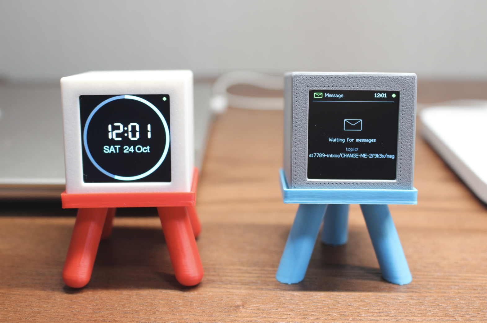
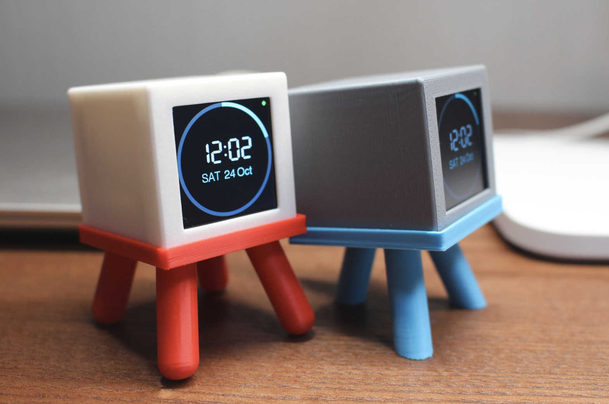
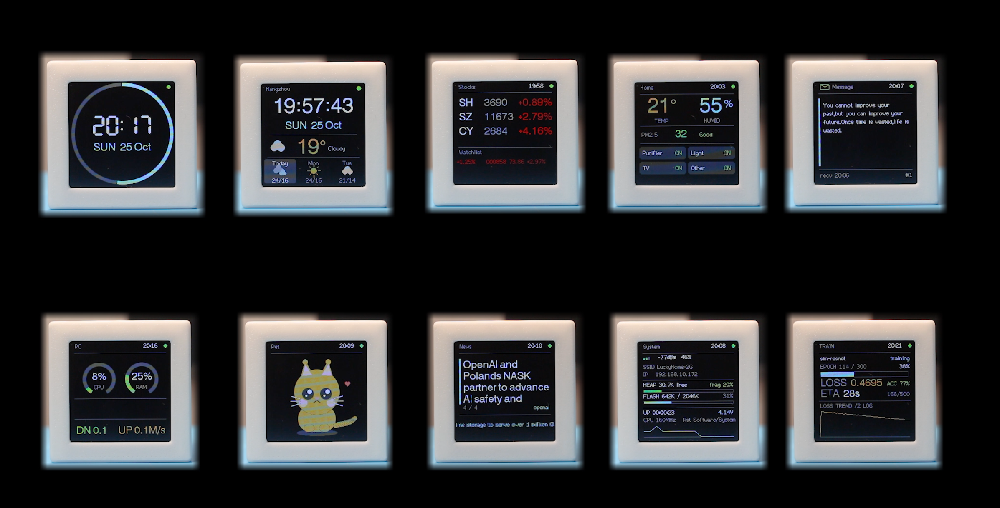

# Desktop Assistant · 桌面信息屏

基于 **ESP-12F (ESP8266)** + **ST7789 240×240 IPS** 的桌面小信息屏，用来显示日常高频信息：天气、股票、时钟、电脑状态、GPU 占用、深度学习训练进度等共 **12 个页面**，支持定时轮播和 MPU6500 **体感翻页**（朝向 + 手势）。所有配置通过设备自带的网页完成，无需改代码、无需重新编译。

## 📷 效果展示

**视频演示**：[【开源】别看它没有巴掌大，桌面上的信息它全包了，30元搞定你的桌面信息屏，它会是终极版吗？](https://www.bilibili.com/video/BV1HHxx65Eqn/)

**图片效果**：





**页面展示**：



## ✨ 功能特性

| 页面 | 数据来源 | 说明 |
| ---- | -------- | ---- |
| 🌤 weather 天气 | 心知天气 API | 当前天气 + 未来 3 天预报 |
| 📈 stock 股票 | 腾讯行情（免 key） | 多只指数/个股，跑马灯滚动 |
| 🏠 home 米家 | Home Assistant REST API | 温湿度 / PM2.5 / 开关状态 |
| 💬 message 消息 | MQTT | 手机/服务器推送消息到屏幕 |
| 📰 news 新闻 | RSS | 英文源标题轮播 |
| ⏰ clock 时钟 | NTP 校时 | 全屏大时钟 + 秒进度环 |
| 💻 pc 电脑状态 | 局域网 HTTP POST | CPU/内存/音量/网速（配套脚本推送） |
| 🎮 gpu 显卡 | 局域网 HTTP POST | NVIDIA 显卡利用率/显存/温度 |
| 🧪 train 训练 | 局域网 HTTP POST | 深度学习训练 loss 曲线 / 进度 |
| 🧭 overview 概览 | 复用以上数据 | 时间 + 天气 + 自选股 + GPU 一屏四格 |
| 🐱 pet 萌宠 | 本地 | 橙猫动画，夜间自动睡觉 |
| ⚙️ system 系统 | 本地 | WiFi/内存/Flash/运行时长/电池电压 |

其他特性：

- **网页配置门户**：AP 强制门户 + mDNS（`http://infodisplay.local/`），改完保存即重启生效
- **体感翻页**：板载 MPU6500，6 个静止朝向 + 4 种手势（甩/双击/摇一摇）均可映射页面
- **OTA 固件升级**：配置页上传 `.bin` 即可，无需接线
- **电池供电友好**：板载分压电路，实时显示电池电压
- **断网兜底**：连不上 WiFi 时自动开放 `InfoDisplay-XXXX` 热点等待配网

> ⚠️ 屏幕字体仅支持 **ASCII（英文/数字/符号）**。天气城市建议用拼音（如 `beijing`），新闻选英文 RSS 源；中文会显示为方框乱码。

## 🗂 目录结构

```
desktop_assistant/
├── code/       # 固件工程（PlatformIO），见下方详细说明
├── doc/        # 文档：页面配置指南.md（每个页面如何配置、数据如何推送）
├── model/      # 3D 打印外壳模型（housing 外壳 / back_cover 后盖 / bracket_0、bracket_1 支架）
└── pcb/        # PCB 资料：嘉立创(立创 EDA)开源工程地址（嘉立创项目地址.txt）
```

`code/` 内部结构：

```
code/
├── platformio.ini      # PlatformIO 工程配置（板级、库依赖、烧录参数）
├── src/                # 固件源码：12 个页面 + 配置门户 + 体感检测等
├── include/            # 头文件
│   └── st7789_setup.h  # TFT_eSPI 屏幕配置（引脚/反显/字体），编译时经 -include 注入
├── lib/                # 项目私有库（预留，可放自改的库）
├── data/               # LittleFS 文件系统内容（cnfont.bin 中文点阵字库，预留）
├── scripts/            # 电脑端辅助脚本（pc_agent.py 数据推送 / 字体与动画制作工具等）
└── test/               # PlatformIO 单元测试目录（预留）
```

## 🔌 硬件接线

屏幕驱动配置集中在 [`code/include/st7789_setup.h`](code/include/st7789_setup.h)：

| ST7789 引脚 | ESP-12F GPIO | 说明 |
| ----------- | ------------ | ---- |
| SCL         | GPIO14       | 硬件 SPI 时钟 |
| SDA (MOSI)  | GPIO13       | 硬件 SPI 数据 |
| DC          | GPIO2        | 数据/命令选择 |
| RST         | GPIO15       | 复位 |
| CS          | GND          | 直接接地，节省一个 IO |
| BLK（背光） | 3.3V         | 工程未定义背光脚，直接常亮即可 |

| 外设 | 引脚 | 说明 |
| ---- | ---- | ---- |
| MPU6500（体感） | I2C：SDA=GPIO4，SCL=GPIO5，地址 0x68 | 未焊/检测不到时固件自动跳过体感功能 |
| 电池电压检测 | ADC（A0/TOUT） | 分压电阻默认 100kΩ(上)/27kΩ(下)，可在 `battery_monitor.h` 构造参数中修改 |

> ESP-12F 需要 **4MB Flash**（工程已按 4MB 配置：2MB 程序 + 2MB LittleFS）。

## 🚀 快速开始

### 1. 安装 PlatformIO

**Windows / Ubuntu 通用方式一（推荐）：VS Code 插件**

1. 安装 [VS Code](https://code.visualstudio.com/)；
2. 扩展市场搜索 **PlatformIO IDE** 并安装；
3. VS Code 中打开本仓库的 `code/` 文件夹，等待插件初始化完成。

**Windows / Ubuntu 通用方式二：命令行**

```bash
pip install -U platformio
# 若提示找不到 pio 命令，使用：python -m pip install -U platformio
```

Ubuntu 下使用 Python 虚拟环境时注意：建议用系统 Python 或 venv 安装，避免 [PEP 668 externally-managed](https://packaging.python.org/en/latest/specifications/externally-managed-environments/) 限制，例如：

```bash
python3 -m venv ~/pio-venv && source ~/pio-venv/bin/activate
pip install -U platformio
```

> **Windows 额外准备**：根据你的 USB 转串口模块安装驱动（CH340 / CP2102 / FTDI），并在「设备管理器 → 端口」里确认分配的 **COM 号**。
>
> **Ubuntu 额外准备**：把当前用户加入 `dialout` 组获得串口权限（注销并重新登录后生效）：
>
> ```bash
> sudo usermod -a -G dialout $USER
> ```

### 2. 配置烧录串口

编辑 [`code/platformio.ini`](code/platformio.ini) 中的 `upload_port`：

- **Windows**：改为你的 COM 号，如 `upload_port = COM5`
- **Ubuntu**：默认 `/dev/ttyUSB0` 即可，也可用 `ls /dev/ttyUSB*` 确认实际设备

也可以不改文件，直接在命令后追加 `--upload-port` 参数（见下文）。

### 3. 编译与烧录

在 `code/` 目录下执行（Windows 用 PowerShell / CMD，Ubuntu 用终端，命令相同）：

```bash
pio run                        # 编译固件
pio run -t upload              # 烧录固件（示例：pio run -t upload --upload-port COM5）
pio run -t uploadfs            # 烧录 LittleFS 文件系统（data/ 目录，建议烧录一次）
pio device monitor             # 串口监视，波特率 115200
```

使用 VS Code + PlatformIO 插件的用户，直接用底栏的 ✔️ 编译 / ➡️ 烧录按钮即可，无需敲命令。

几点说明：

- **首次编译**会自动下载工具链和依赖库（TFT_eSPI、ArduinoJson、NTPClient、PubSubClient），需要联网，耐心等待几分钟；
- `uploadfs` 会把 `data/` 下的字库等资源写入 LittleFS 分区，建议固件烧录后执行一次（固件本身带默认配置，**不烧也能开机，不影响使用**）；
- 烧录前请先把设备通过 USB 转串口连接电脑。工程默认使用 **nodemcu 自动下载电路**（DTR/RTS 控制）；
- 若 921600 波特率烧录不稳定，把 `platformio.ini` 中 `upload_speed` 改为 `115200` 或 `460800`；
- 编译产物 `.bin` 位于 `.pio/build/esp12e/firmware.bin`，可用于网页 OTA 升级。

### 4. 首次开机配置

1. 上电后设备未联网，会自动开放热点 **`InfoDisplay-XXXX`**（无密码，XXXX 为芯片 ID）；
2. 手机/电脑连上该热点，浏览器打开 **`http://192.168.4.1`**（一般会自动弹出配置页）；
3. 在「网络」卡片填好 WiFi 名称和密码，点「保存并重启」；
4. 联网后通过 **`http://infodisplay.local/`**（或设备 IP，屏幕系统页可见）访问配置页。

所有页面开关、轮播顺序、停留时长、体感映射、各页面 API 配置（天气 key、股票代码、HA 令牌、MQTT 主题等）全部在网页中完成。**详细的逐页配置说明见 [doc/页面配置指南.md](doc/页面配置指南.md)。**

## 💻 电脑端数据推送（可选）

更具体的使用方法，也可参考[页面配置指南](./doc/页面配置指南.md)

`pc`（电脑状态）、`gpu`（显卡）、`train`（训练进度）三个页面的数据由电脑上的脚本通过局域网 HTTP POST 推送，仓库里已提供现成脚本：

| 脚本 | 用途 |
| ---- | ---- |
| `scripts/pc_agent.py` | 每秒采集 CPU/内存/音量/网速推送 `/pc`；有 NVIDIA 显卡时同时推 `/gpu` |
| `scripts/train_report.py` | 在训练循环中实时上报 loss/acc 到 `/train`（非阻塞，失败静默忽略） |
| `scripts/train_sim.py` | 生成模拟训练数据，用于验证显示效果 |
| `scripts/ha_mock.py` | 模拟 Home Assistant 数据，用于测试米家页 |

以 `pc_agent.py` 为例：

```bash
pip install psutil requests
# 编辑 scripts/pc_agent.py，把顶部 ESP_IP 改成设备 IP
python scripts/pc_agent.py
```

Windows 读取系统音量需额外 `pip install pycaw comtypes`；Ubuntu 需 `sudo apt-get install pulseaudio-utils`。字段格式和 curl 手动测试方法见 [doc/页面配置指南.md](doc/页面配置指南.md)。

## ❓ 常见问题

| 问题 | 解决办法 |
| ---- | -------- |
| 屏幕颜色反了 | 注释掉 `include/st7789_setup.h` 中的 `TFT_INVERSION_ON` 后重新编译 |
| 中文显示成方框 | 固件字体仅支持 ASCII，请使用英文/拼音（中文点阵字库在 `data/` 中，固件暂未接入） |
| Ubuntu 下串口打不开 | `sudo usermod -a -G dialout $USER` 后注销重新登录 |
| 烧录失败/校验错误 | 降低 `upload_speed`；裸模组检查 GPIO0 是否拉低进下载模式 |
| `infodisplay.local` 打不开 | 用设备 IP 直接访问（配置页顶栏或系统页可见） |
| 体感不翻页 | 确认 MPU6500 焊接正常（串口日志无 `mpu` 报错）；朝向含义随摆放姿势而定，按指南校准 |
| 忘记 WiFi 密码 | 断掉路由器后重新上电，设备会自动回到 AP 配网模式 |

## ⚠️ 焊接注意事项

- 如果能接受长期使用USB线供电，也可以不焊接电池；
- **屏幕排线焊接的时候，不要平铺在PCB板上，最好形成一定的夹角；**
- 整体焊接难度还好，MPU6500难度稍大一些，细致一些问题也不大。

## 📄 许可

本项目基于 [Apache License 2.0](LICENSE) 开源。

## 🙏 致谢

本项目基于以下开源库构建：

- [TFT_eSPI](https://github.com/Bodmer/TFT_eSPI)（屏幕驱动）
- [ArduinoJson](https://arduinojson.org/)（JSON 解析）
- [PubSubClient](https://github.com/knolleary/pubsubclient)（MQTT）
- [NTPClient](https://github.com/arduino-libraries/NTPClient)（网络校时）
- 外壳模型、PCB 资料见 `model/` 与 `pcb/` 目录
